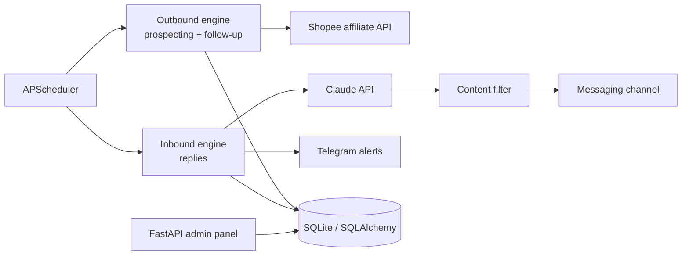

<h1 align="center">AI Affiliate Outreach Bot</h1>

24/7 automation that finds and talks to affiliates using generative AI

    

> **Note:** the source code is private (production systems). This repository is a technical overview: what it does, how it is built and what it looks like. Happy to walk through the code in an interview — reach me on [LinkedIn](https://www.linkedin.com/in/guilherme-vytacore/).

## Overview

A bot that runs around the clock with two engines:

- **Prospecting:** finds content creators through Shopee's official affiliate API, makes the first contact and runs a follow-up cadence.
- **Support:** reads replies, answers questions with generative AI based on a playbook and escalates non-standard negotiations to the team.

## Highlights

- **Generative AI (Claude API)** to rewrite and answer messages from a playbook
- **Content filter before every send** and safety rules covered by tests (limit on unanswered messages, daily quota, duplicate-message check)
- **Shopee affiliate API**: recommended affiliates and targeted campaigns
- **Google Sheets playbook** and Telegram alerts for the team
- **Dry-run mode** to validate every action before going live
- **Deployed on a Linux VPS** with Docker and Coolify, admin panel behind an HTTPS proxy

## Architecture

## Tech stack

Python 3.12, FastAPI, Uvicorn, SQLAlchemy, Pydantic, APScheduler, Typer, httpx, Anthropic SDK, gspread, pytest, Docker

---

<b>Versão em português</b>

> **Observação:** o código-fonte é privado (sistemas em produção). Este repositório é uma visão técnica do projeto. Posso apresentar o código em uma entrevista — fale comigo pelo [LinkedIn](https://www.linkedin.com/in/guilherme-vytacore/).

## Visão geral

Robô que trabalha 24 horas por dia em dois motores: **prospecção** (encontra criadores pela API oficial de afiliados da Shopee, faz o primeiro contato e o follow-up) e **atendimento** (responde dúvidas com IA generativa e encaminha negociações fora do padrão para a equipe).

## Destaques

- **IA generativa (Claude API)** para reescrever e responder mensagens com base num playbook
- **Filtro de conteúdo** antes de cada envio e regras de segurança cobertas por testes
- **API de afiliados da Shopee**: afiliados recomendados e campanhas exclusivas
- **Playbook no Google Sheets** e alertas no Telegram
- **Modo de simulação** para validar tudo antes de ligar
- **Publicado em VPS Linux** com Docker e Coolify

## Stack

Python 3.12, FastAPI, Uvicorn, SQLAlchemy, Pydantic, APScheduler, Typer, httpx, Anthropic SDK, gspread, pytest, Docker

